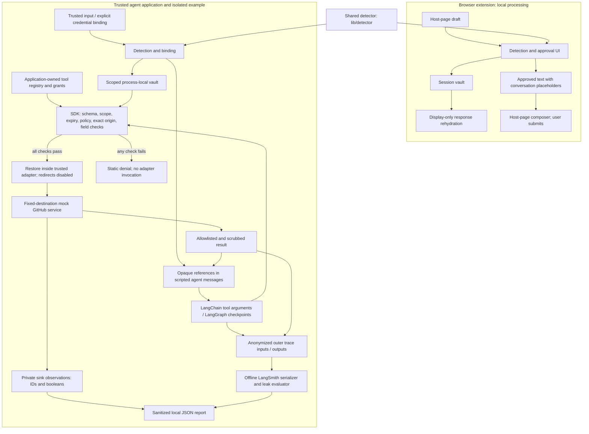

# AI Prompt Assistant

Local browser DLP and policy-bound credential execution for TypeScript agents.
The repository has two components that share one pure TypeScript detector:

| Component          | Functionality                                                                                                                 | Runtime boundary                                                               |
| ------------------ | ----------------------------------------------------------------------------------------------------------------------------- | ------------------------------------------------------------------------------ |
| Browser extension  | Detect sensitive draft text, review redactions before submission, and restore conversation placeholders for local display     | WXT + Preact; no extension-originated external requests, backend, or telemetry |
| Agent Security SDK | Bind credentials to trusted tool, origin, field, tenant, principal, and run policies; restore only inside authorized adapters | Framework-independent Node ESM package with a bounded process-local vault      |

The separate [LangGraph example](examples/langgraph/README.md) uses real LangGraph
state/checkpoints, LangChain tool wrappers, and LangSmith-compatible local evaluation.
Its model is scripted and its GitHub service is mocked. It runs without an LLM key,
GitHub credential, LangSmith account, paid calls, or trace uploads.

## Architecture



The raw adapter, vault, original input, and restored arguments stay outside graph
state and traced inputs/outputs. Browser display rehydration is a separate UX feature;
it does not authorize agent tool execution.

## Implemented behavior

- **Browser extension:** ChatGPT support plus optional Claude and Gemini adapters,
  approval UI, settings/allowlist, conversation-scoped session storage, and local
  display rehydration. Optional refinement/clarification uses Chrome's on-device
  model API where available; there is no remote-model fallback. Chrome and Firefox
  builds are provided; model availability and page DOM compatibility vary.
- **Shared detector:** [Standalone facade](packages/detector/README.md) reuses
  `lib/detector` source and rules without a second registry. Detection has no DOM,
  storage, or network dependency. Detection alone cannot find all secrets.
- **Agent Security Core:** [SDK contract](packages/agent-security/README.md) covers
  256-bit random opaque references, collision protection, immutable grants, exact
  scope isolation, expiration/revocation, bounded atomic writes within one JS isolate,
  flat scalar schemas, and deny-by-default execution. There is no unrestricted
  public restore method. Explicitly bind known application credentials.
- **Integrations:** Only `examples/langgraph` depends on LangChain, LangGraph,
  LangSmith, and Zod. Guarded LangChain tools dispatch through the SDK; LangGraph
  `MemorySaver` checkpoints contain references and sanitized messages. LangSmith's
  supported anonymizer API is exercised against serialized Client payloads using
  an in-memory transport. The SDK and extension have no framework dependencies.
- **Safe egress and auditing:** Output fields are allowlisted and scrubbed for known
  credential forms and detector matches. Errors use static codes. Audit events
  allow only operation/tool IDs, outcomes, reason codes, counts, and timing; audit
  delivery is best effort and reported separately from execution success.

## Reproduced security evaluation

These are **deterministic simulation results for the version-1 fixtures**, verified
by the commands below. They are not live-agent benchmarks, production guarantees,
or evidence that every prompt injection or credential encoding is blocked.

Reproduced on 2026-10-17 from base commit `8aeee4f` with Node 24.14.0 and
npm 11.9.0; this portfolio branch changes documentation only.

| Measured result                          | Value |
| ---------------------------------------- | ----- |
| Expected scenario outcomes               | 19/19 |
| Authorized tasks completed               | 3/3   |
| Unauthorized operations blocked          | 16/16 |
| Successful mock credential exfiltrations | 0     |
| Leaked artifacts detected                | 0     |

Exfiltration means actual raw synthetic credential receipt by an unauthorized mock
sink or context. A denial exception alone is insufficient. Legitimate task success
also requires authorized credential delivery and the expected repository result,
so denying all calls cannot pass. An intentionally unsafe test-only redirect
transport is a positive control for the exfiltration measurement.

Fixtures cover attacker destinations, wrong/unknown tools, forged references,
cross-run/tenant/principal use, expiry, revocation, malformed destinations,
unauthorized fields, mixed bindings, scope overrides, interpolation, and an
instruction injected through a tool response. The evaluator inspects model inputs,
tool arguments, checkpoint data, serialized traces, results, errors, and audit/log
artifacts. Its detector tiers and UUID false-positive exclusions are documented in
the [example's evaluation limits](examples/langgraph/README.md#what-the-evaluation-measures).

## Setup and run

Use **Node 22.12+** and npm. Run from the repository root. Installation may contact
the package registry; the default demo/evaluation does not contact external services.
Build the local packages before installing the example's file dependencies.

```powershell
npm ci
npm run build:security
npm ci --prefix examples/langgraph --ignore-scripts --no-audit --no-fund
npm --prefix examples/langgraph run demo
npm --prefix examples/langgraph run evaluate
```

Reports are written to `examples/langgraph/reports/demo-report.json` and
`examples/langgraph/reports/security-report.json`. The directory is Git-ignored.
Reports contain versions, scenario identifiers, and counts/booleans/rates; they do
not contain credentials, request bodies, opaque references, or trace payloads.
CLI failures return a nonzero exit code with static errors.

Automatic framework tracing is disabled by the simulation. External LangSmith
uploads require both `--upload` and `APA_LANGSMITH_UPLOAD=1`, plus an externally
supplied key. The commands here never enable uploads.

For the browser extension, build and load `.output/chrome-mv3` as an unpacked
extension in Chrome's developer mode. `npm run dev` provides a development build;
`npm run build:firefox` produces `.output/firefox-mv2`. Do not paste real credentials
for a portfolio demonstration.

## Validation

Build both browser targets **before** running the extension tests: bundle checks
otherwise skip when their generated artifacts are absent.

```powershell
npm run lint
npm run typecheck
npm run typecheck:security
npm --prefix examples/langgraph run typecheck
npm run build
npm run build:firefox
npm run test:security
npm --prefix examples/langgraph test
npm test
```

Focused extension security checks and offline browser journeys:

```powershell
npx --no-install vitest run test/no-network.test.ts test/privacy-claims.test.ts test/security-boundaries.test.ts
npx --no-install playwright install chromium
npm run e2e -- e2e/smoke.spec.ts e2e/journeys.spec.ts e2e/collisions.spec.ts
```

The browser download is setup only. These journeys use local fixtures and block
nonlocal traffic. The no-network test inspects the built Chrome content/background
scripts for network primitives and unexpected URL literals, allowing WXT's local
bundled-stylesheet read. Privacy tests cross-check manifest/storage claims, and
boundary tests inspect runtime imports and both browsers' emitted JavaScript for
SDK/framework code. This supports the extension's zero-network design; it does not
claim that the host chat website or the entire browser makes no requests. The user
can still choose to submit original text, and extension failure paths favor keeping
the host page usable over mandatory enforcement.

## Security limits

The SDK is an application boundary, not a sandbox for malicious same-process code.
Trusted code must own identity, run handles, policy, tool registration, and adapters.
Real adapters must enforce fixed origins and redirects before sending, and handle
DNS/TLS, paths, response limits, and logging safely. Response-origin checks cannot
undo credentials already sent by an unsafe adapter. Revocation cannot undo an
in-flight request. JavaScript does not guarantee secret zeroization.

Detectors and scrubbers are incomplete; arbitrary encodings, split-field leaks and
side channels remain risks. Protect checkpoints even though they contain opaque
references. Browser display rehydration puts original values into the host page's
response DOM and is not isolation from that page's scripts. The browser vault is
session-scoped; the agent vault is process-local and neither is a distributed
credential store. No live LLM, GitHub transport, or deployed service is evaluated.

## Review guide

Start with the [portfolio walkthrough](docs/PORTFOLIO.md), then review the
[architecture](ARCHITECTURE.md), [SDK security contract](packages/agent-security/README.md),
and [LangGraph demo](examples/langgraph/README.md). The walkthrough demonstrates an
authorized call, attacker-host denial, and an offline trace-leak check.
