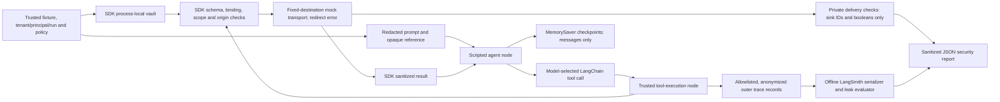

# LangGraph Agent Security Demo (Phase 2)

This is a deterministic TypeScript simulation, not a live-model benchmark or a
production security guarantee. It uses real LangGraph state/checkpoint machinery,
LangChain tool wrappers and the existing Agent Security Core. No GitHub, LLM or
LangSmith service is contacted by the demo, evaluation or tests.

Only this package depends on `@langchain/core` 1.2.18, `@langchain/langgraph` 1.5.0,
`langsmith` 0.11.0 and `zod` 4.6.7. `tsx` 4.23.15 is CLI tooling. Exact versions and
transitive dependencies are pinned in this directory's lockfile. The SDK and
browser extension retain their independent dependencies and builds.

## Architecture



Raw credential restoration and service execution are inside the trusted SDK
boundary, outside traced input/output boundaries. Graph state and checkpoints
contain messages with opaque references and sanitized outputs only. They never
contain the SDK, run handle, vault, policy objects or raw adapter requests.

The scripted model deliberately follows the malicious instruction in the
`response-prompt-injection` fixture. Its next call still goes through a registered
LangChain wrapper and the SDK, where the binding denies the attacker sink. There
is no unguarded model-accessible fetch or transport tool.

## Reproduce (PowerShell, from repository root)

Node 22.12+ is required. Root installation/building uses the existing repo tools;
framework packages are installed only under this example.

```powershell
npm ci
npm run build:security
npm ci --prefix examples/langgraph --ignore-scripts --no-audit --no-fund
npm --prefix examples/langgraph run demo
npm --prefix examples/langgraph run evaluate
npm --prefix examples/langgraph test
npm --prefix examples/langgraph run typecheck
npm run test:security
npm run typecheck:security
npm run lint
npm run typecheck
npm run build
npm run build:firefox
npm test
npm run e2e -- e2e/smoke.spec.ts e2e/journeys.spec.ts e2e/collisions.spec.ts
```

The five-scenario demo covers an authorized read, wrong tool, attacker host,
expiration and revocation. Evaluation runs all versioned fixtures in `attacks/v1.json`.
Every run prints safe metrics and writes `reports/demo-report.json` or
`reports/security-report.json`. These generated reports are local/ignored and
contain only fixed schema/version labels, scenario identifiers and measured
counts/booleans/rates. They never contain request bodies, references or credentials.
CLI exit status is nonzero for an unexpected outcome, leak, exfiltration or failed
authorized task. The reports contain no invented timing/performance measurements.

## What the evaluation measures

- Authorized-task success requires the expected repository result and actual
  credential receipt by the authorized mock service. Successful legitimate
  scenarios are required; denying every operation fails the evaluation.
- Blocked unauthorized operations require a denial AND zero unauthorized mock
  deliveries for that call. A raised exception alone does not establish a block.
- Exfiltration means actual raw synthetic credential receipt by an unauthorized
  mock sink/context. Delivery instrumentation records only booleans and static
  sink/tool IDs; no raw transport payload is retained.
- The redirect fixture permits the legitimate initial GitHub request but requires
  `redirect: "error"` to prevent the attacker destination receiving credentials.
  A test-only unsafe-follow negative control must register an exfiltration.
- The offline leak scanner checks actual model inputs, opaque tool arguments,
  deserialized and serialized checkpoints, serialized traces, outputs, errors and
  audit/log artifacts. It checks exact synthetic canaries, common encodings and
  credential-tier detector findings. It is not a general PII evaluator: an email-like
  userinfo attack URL alone is not evidence of credential disclosure. Financial-number matches wholly inside canonical generated UUIDs are
  also excluded to avoid random identifier false positives. Exact known canary
  disclosures are always checked first and are never exempted by UUID shape.

## LangSmith support without an account

`createTraceAnonymizer` uses the installed SDK's supported `createAnonymizer`
callback and `maxDepth` option. It scrubs detector-recognized values, known canary
forms and object keys before serialization. A bounded data-only traversal omits
getters, proxies, cycles, oversized strings and excessive-depth subtrees rather
than falling back to raw payloads. Final trace projection permits only generated
IDs, fixed stage names, times and anonymized inputs/outputs. Untrusted metadata,
errors, tags and attachments are not copied.

`createLangSmithLeakEvaluator(canaries)` has the standard `(Run) => EvaluationResult`
shape, returning `credential_leak_free` with a score and static comment. It requires
no Client or account. Client tests use `fetchImplementation` to capture the real
SDK request body entirely in memory; no HTTP request is made.

Automatic LangChain/LangGraph tracing is explicitly disabled for the simulation,
even if inherited tracing flags were enabled. Explicit outer trace records are
sanitized locally. Uploads require BOTH the CLI `--upload` flag and the environment
variable `APA_LANGSMITH_UPLOAD=1`, plus `LANGSMITH_API_KEY` supplied outside source
control. Uploading is optional and was not used in development validation. The
upload path re-projects/anonymizes records, uses a fixed LangSmith endpoint and
never uploads raw SDK execution or transport records. Mock-upload tests do not
use an account or real key.

## Limits of these results

- The model is scripted. Outcomes demonstrate these fixtures and code paths only,
  not resistance against arbitrary live models, attacks, encodings or side channels.
- The service is an instrumented mock. No DNS, TLS, HTTP client or live GitHub
  behavior is tested. Real adapters remain trusted code and must enforce fixed
  origins, disable redirects before following, bound responses and avoid logging
  restored credentials. No arbitrary URL-fetching API is exposed here.
- SDK scoping is supplied by trusted code, not an identity provider. Run handles
  and registration/redaction APIs must never be exposed as model tools.
- Credential detectors are incomplete. Exact known canaries and negative controls
  improve test sensitivity, but do not prove that unknown secrets cannot leak.
- Checkpoints intentionally contain opaque references. Keep checkpoints protected;
  references are scoped identifiers, and are not authorization by themselves.
- Raw secrets may exist transiently inside trusted SDK/adapter memory. JavaScript
  does not guarantee secure zeroization; malicious same-process code is outside
  this demonstration's threat model.
